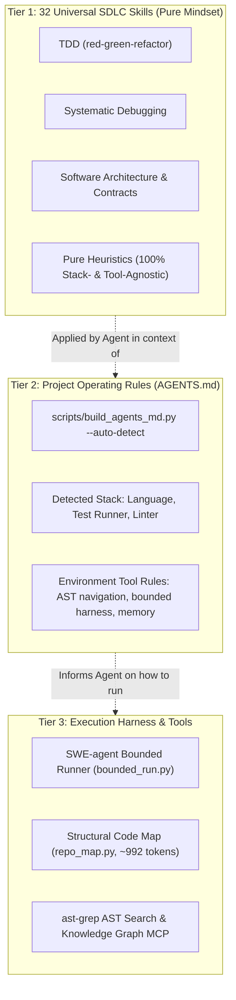

# Pack Architecture – Universal SDLC Agent Skills

> **Document type:** Architectural Source of Truth  
> **Pack:** Universal SDLC Agent Skills Pack  
> **Version:** 0.1.0  
> **Status:** Approved  
> **Last updated:** 2026-11-04  

---

## 1. Purpose and Scope

### 1.1 Purpose
The **Universal SDLC Agent Skills Pack** is a modular, portable engineering capability system that guides AI coding agents to turn software work requests into well-defined engineering artifacts and verifiable outcomes.

The governing principle of the pack is **flexible input, disciplined output**. A task may begin with a plain-language prompt, partial context, an existing codebase, a confirmed technology stack, or a formal specification. The pack does not require a rigid intake questionnaire or a mandatory `STACK.md` before useful engineering work can begin. It enforces discipline at the output boundary: making expected outcomes, constraints, assumptions, and empirical verification status explicit, while never concealing uncertainty or asserting unverified test claims.

### 1.2 In Scope
- End-to-end SDLC capability coverage across 16 stages (11 core lifecycle stages and 5 cross-cutting capability areas).
- Multi-agent runtime portability across Antigravity, Claude Code, Cursor, GitHub Copilot, Codex, and OpenCode.
- A single canonical router (`using-sdlc-skills`) driving demand-driven skill selection.
- 32 canonical artifact templates across 5 functional groups (`contracts/`, `specs/`, `delivery/`, `platform/`, `governance/`) with explicit ownership contracts.
- 11 standardized workflows covering core development, defect remediation, refactoring, and maintenance scenarios.
- Strict upstream provenance tracking, content hashing, and transactional sync safety.

### 1.3 Out of Scope
- Proprietary vendor lock-in or dependency on closed SaaS workflow platforms.
- Autonomous, unmonitored production deployments without explicit human-in-the-loop approval.
- Enforcing monolithic waterfall processes on simple, isolated tasks (e.g., bug fixes or quick text edits).
- Replacing team communication or human architectural stewardship.

### 1.4 Operating Context
The pack operates within diverse AI agent runtimes, shell environments (Bash, Zsh, PowerShell), and host operating systems (Linux, macOS, Windows). Runtime capabilities differ: some support selective on-demand tool loading, while others load all installed instructions upfront. The architecture defines canonical behavior and provides thin adapters to normalize runtime differences.

---

## 2. Architectural Principles

- **Flexible input, disciplined output:** Accept flexible, partial, or evolving intake context; enforce rigorous verification, explicit assumptions, and strict contract conformance on outputs.
- **Capability-oriented, not workflow-prescriptive:** The pack describes available capabilities in the Practical Matrix. A task activates only the workflows, stages, and skills relevant to its scope; stages may branch, repeat, or be skipped.
- **Modular responsibilities:** Maintain clean boundaries between skills (domain procedures), workflows (coordination), contracts (output expectations), templates (scaffolding), tools/adapters (execution), and package metadata.
- **One source of truth per concern:** Assign one authoritative owner to every canonical fact. Derived views are generated or verified against authoritative sources.
- **Demand-driven task context:** Discover and load the smallest sufficient set of skill instructions into the agent prompt context. Expand incrementally only when the task requires it. Never enforce an artificial numerical limit.
- **LLM for judgment, tools for deterministic work:** Reserve LLM reasoning for ambiguity, planning, qualitative evaluation, and synthesis. Delegate deterministic tasks (formatting, linting, compilation, test execution) to CLI tools, scripts, and automated pipelines.
- **Cost-aware execution:** Manage LLM context window tokens, external API/model credits, and local compute resources as distinct cost dimensions.
- **Provider and runtime neutrality:** Keep domain skills portable and decoupled from specific model providers or IDE runtimes. Place vendor-specific behavior in thin adapters.
- **Evidence-based quality:** Require fresh, verifiable execution evidence before asserting that any test, check, or criteria has passed.
- **Safe and recoverable change:** Ensure all sync, packaging, installation, and code modifications are non-destructive, previewable, and recoverable by default.
- **Honest implementation status:** Explicitly distinguish implemented components from manual procedures and target capabilities.

---

## 3. Core Concepts and Sources of Truth

| Concept | Definition / Responsibility | Authoritative Source |
|---|---|---|
| **Practical Matrix** | Curated map of SDLC stages, roles, artifacts, competencies, and candidate skills. Defines capability scope, not runtime loading or mandatory sequence. | [`docs/sdlc-practical-matrix.md`](sdlc-practical-matrix.md) |
| **Packaged Inventory** | Skills actually distributed by the repository (32 Universal SDLC skills), verified against commit locks and content hashes. | [`upstream.json`](../upstream.json), [`manifests/skill-provenance.json`](../manifests/skill-provenance.json) |
| **Stable Skill ID** | Canonical identifier that remains stable across upstream renames, file moves, or path refactoring. | [`upstream.json`](../upstream.json), `manifests/skill-map.json` |
| **Core / Extras** | Tiering policy: Core (29) skills provide universal engineering discipline installed by default; Extras (34) skills provide contextual stack/domain capabilities loaded on demand. | [`docs/stage-skill-map.md`](stage-skill-map.md) |
| **Task Active Skills** | The minimal subset of skills dynamically selected and loaded into context for the current task step. Distinct from installed skills. | Runtime execution state / `.agent/tasks/<task-id>.md` |
| **Workflow Definition** | Coordination patterns specifying entry triggers, stages, handoffs, and verification gates without embedding domain skill logic. | [`workflows/`](../workflows/) |
| **Task Contract** | Lightweight statement of task goal, constraints, assumptions, referenced artifact contracts, and required verification. | Runtime convention / `docs/features/<feature-id>/plan.md` |
| **Artifact Contract** | Canonical specification of one deliverable's purpose, structure, acceptance criteria, and verification methods. | [`templates/README.md`](../templates/README.md) & [`docs/stage-skill-map.md`](stage-skill-map.md) |
| **Starter Template** | Pre-structured Markdown/code template instantiating an artifact contract on disk at a canonical project path. | [`templates/`](../templates/) |
| **Completion Report** | Explicit report of task status (`completed`, `partially completed`, `blocked`, `failed`), deliverables, checks run with evidence, and limitations. | Output response / `docs/features/<feature-id>/acceptance-report.md` |

### 3.1 Contract Relationship

```text
User Request + Available Context (Repo, STACK.md, Prompts)
                      |
                      v
                Task Contract
         - goal, scope, constraints, assumptions
         - target artifact(s)
         - acceptance & verification criteria
                      |
                      +---- references ----> Artifact Contract(s)
                      |                     (templates/ & docs/stage-skill-map.md)
                      v
             Workflow Definition (workflows/*.md)
         - coordinates stages, handoffs, and gates
         - selects Smallest Sufficient Set of Skills
                      |
                      v
           Domain Skill Execution
         - TDD, Refactoring, Architecture, Security
         - scaffolds canonical templates into project paths
                      |
                      v
             Produced Artifact(s)
                      |
                      v
          Empirical Verification Gate (verification-before-completion)
         - test runner, linters, contract checkers
                      |
                      v
              Completion Report
         - status, evidence, limitations
```

---

## 4. Pack Architecture

### 4.0 3-Tier Decoupled Architecture

The pack enforces a strict 3-tier decoupling to preserve skill purity, token efficiency, and cross-agent portability:



1. **Tier 1 — Universal SDLC Skills (`skills/`)**: 32 canonical engineering skills containing pure heuristics and universal software engineering discipline (TDD red-green-refactor, systematic debugging, contract-first design, incremental slices). 100% stack-agnostic and tool-agnostic without hardcoded script names.
2. **Tier 2 — Project Operating Rules (`AGENTS.md`)**: Project-level rulebook at repository root. Automatically generated via `python scripts/build_agents_md.py --auto-detect` to inspect the project manifests and local harness. Read once by the agent upon session startup.
3. **Tier 3 — Execution Harness & Environment**: Local runtime tooling (`bounded_run.py`, `repo_map.py`, `ast-grep`, `memory` MCP).

### 4.1 Component Breakdown

| Component | Responsibility | Inputs | Outputs | Dependencies / Boundaries | Status |
|---|---|---|---|---|---|
| **Skills** (`skills/`, `extras/`) | Domain procedures, engineering heuristics, TDD/architecture guidance. | Task context, prompts | Code changes, artifacts | Tool execution, adapters | Implemented (63 skills) |
| **Workflows** (`workflows/`) | Multi-step lifecycle coordination, handoffs, routing, and gates. | Task intent | Ordered execution plan | Skills, Contracts | Implemented (11 workflows) |
| **Contracts & Templates** (`templates/`) | Canonical artifact structures, acceptance criteria, and scaffolds across 5 functional directories. | Domain requirements | Validated deliverables | Skills, Workflows | Implemented (32 templates) |
| **Tools & Scripts** (`scripts/`) | Deterministic execution: linting, packaging, syncing, installing, bounded execution, and contract verification. | CLI args, manifest | Formatted files, exit codes | Python runtime, OS shell | Implemented |
| **Adapters** (`adapters/`) | Agent runtime-specific configuration, directory mapping, and installation. | Generic pack | Target runtime assets | Host IDE / CLI environment | Implemented (8 runtime targets) |
| **Manifests & Registries** (`manifests/`) | Machine-readable provenance, lockfiles, content hashes, and skill maps. | Upstream configs | Verified package state | Repository files | Implemented |
| **Evaluation & Tests** (`tests/`) | Static validation, sync transaction tests, contract assertions. | Pack files, mock repos | Test reports, CI exit codes | Python `unittest` | Implemented (20 unit tests) |

### 4.2 Responsibility Boundaries

- **Agent / LLM:** Context normalization, goal interpretation, architectural trade-off evaluation, task planning, and qualitative synthesis.
- **Skills:** Domain instructions, BDD/TDD steps, threat modeling criteria, and idiomatic best practices.
- **Tools / CLI / MCP:** Concrete execution engines (Git, Docker, Playwright, compilers, test runners, linters).
- **Scripts / Pipelines:** Deterministic batch operations (pack linting, upstream sync transactions, automated installer).
- **Human:** Final acceptance sign-off, production deployment approvals, and high-impact architectural decisions.

---

## 5. Pack Development, Curation, and Distribution

The pack lifecycle follows a strict transactional flow:

```text
Upstream / Local Sources
           |
           v
Discovery & Inspection (upstream.json)
           |
           v
License & Security Review (THIRD_PARTY_NOTICES.md)
           |
           v
Selection & Classification (Direct Reuse / Adaptation / Local Authorship -> Core vs. Extras)
           |
           v
Transactional Sync & Validation (scripts/sync_upstream.py -> scripts/lint_pack.py --strict)
           |
           v
Packaged Inventory (manifests/skill-provenance.json, upstream-lock.json)
           |
           v
Distribution & Installation (scripts/install.py)
```

For every accepted skill, the repository records:
- Stable skill ID and destination tier (`skills/` or `extras/`);
- Upstream Git URL, revision commit SHA, and exact source path;
- Inheritance method (`Direct reuse`, `Adaptation`, `Local authorship`);
- License type and required attribution notices;
- SHA-256 content hashes to guarantee integrity against tampering.

### 5.1 Skill Consolidation and Context Budget Strategy
To protect agent prompt budgets against context degradation, the pack maintains a strict token economy:
- **Upstream Harvest vs. Packaged Footprint:** The pack maintains 32 Universal SDLC Competency Centers to avoid functional redundancy and overlap.
- **Description Budgeting:** Frontmatter `description` fields are strictly budgeted under 25 words with explicit trigger phrases (`Use when...`, `Use for...`), eliminating keyword spamming and keeping total catalog metadata under ~2.5k tokens.
- **Hierarchical Modularization:** Specialized secondary skills are integrated as progressive disclosure sub-modules, runbooks, or reference playbooks inside their parent primary skills rather than polluting top-level agent discovery.

---

## 6. Workflow and Orchestration

### 6.1 Workflow Model

The pack provides **11 standardized workflows** in [`workflows/`](../workflows/) covering 5 core operational scenarios:

| Workflow | Scenario Group | Trigger / Input | Primary Stages | Key Output | Verification / Exit Gate |
|---|---|---|---|---|---|
| `full-sdlc.md` | Construction | Complex initiatives, greenfield projects | Discovery → Req → Arch → Plan → Impl → Test → Release | Full feature release & docs | Full test suite, acceptance report |
| `feature-loop.md` | Construction | Standard feature request | Spec → Plan → TDD Slice → Review → Handoff | Working feature slice | Tests passing, DoD satisfied |
| `quick-change.md` | Construction | Minor tweak, copy change, isolated fix | Direct TDD edit → Local verification | Atomic commit | Targeted test verification |
| `bug-fix.md` | Defect | Defect report, failing test | Reproduce (Red) → Isolate → Fix (Green) → Refactor | Bug fix commit | Regression test passing |
| `incident-response.md` | Defect | Production alert, outage | Triage → Contain → Mitigate → Root Cause → Postmortem | Postmortem & remediation | System SLO recovered |
| `refactoring.md` | Maintenance | Technical debt, code smell | Characterization tests → Safe refactor → Verify | Cleaned codebase | Zero regression in behavior |
| `performance-tuning.md` | Maintenance | High latency, bottleneck | Profile baseline → Benchmark → Optimize → Verify | Optimized code & metrics | Benchmark shows latency reduction |
| `dependency-upgrade.md` | Maintenance | Security advisory, outdated package | Audit deps → Staged bump → Integration tests | Upgraded lockfile | Full test suite & security check |
| `deprecation-and-migration.md` | Maintenance | Obsolete API/schema | Deprecation notice → Expand/Contract → Sunsetting | Migration scripts & notice | Zero downtime across clients |
| `experimentation-loop.md` | Learning | Growth hypothesis, A/B test | Hypothesis → Variant code → Telemetry → Evaluation | Experiment brief & data | Statistical significance report |
| `agent-handoff-contract.md` | Coordination | Long session, agent handoff | State capture → Context summary → Next steps | `.agent/tasks/<task-id>.md` | Task session file updated |

### 6.2 Orchestration Rules
- Single pack router: `using-sdlc-skills` is the exclusive pack router.
- Atomic sequencing: Workflows assemble focused skills dynamically rather than duplicating procedures.
- Non-linear agility: Any workflow may skip, branch, or return to an earlier phase when new evidence emerges.

---

## 7. Skill Discovery, Selection, and Loading

The architecture strictly decouples physical installation from context loading:

| Layer | Scope | Mechanism |
|---|---|---|
| **Installation** | Target environment disk | `scripts/install.py` installs 32 Universal SDLC skills. |
| **Discovery & Selection** | Task-specific scope | Router identifies the Smallest Sufficient Set from packaged inventory. |
| **Context Loading & Activation** | Agent working memory | Loads only relevant `SKILL.md` instructions; defers large references until needed. |

### Demand-Driven Feedback Loop
1. **Task Intake:** Ingest request and available context without requiring rigid intake forms.
2. **Discover & Select:** Router identifies matching workflow, 1–3 skills, and matching artifact template.
3. **Load & Scaffold:** Load primary skill instructions; scaffold the starter template to the canonical target path.
4. **Execute & Expand:** Execute work iteratively. If a new subtask or domain need emerges, load additional skills on demand.
5. **Verify Output:** Validate deliverables against canonical artifact contracts using fresh verification evidence.

---

## 8. Tool Execution Architecture

### 8.1 Execution Strategy
- **CLI-First:** Prefer standard, scriptable CLI utilities (Git, npm, pytest, docker, curl) and language toolchains.
- **Tool-Neutral Skills:** Skills provide engineering methodology, heuristics, and review standards; they do not hardcode vendor lock-in.
- **Thin Adapters:** Isolate vendor-specific CLI flags, API endpoints, and authentication in dedicated adapters.

### 8.2 Execution Abstraction
- Deterministic multi-step operations are packaged into standalone Python scripts in [`scripts/`](../scripts/) with standard exit codes (0 for success, non-zero for failure).
- Agents coordinate and inspect high-level operations rather than emitting repetitive low-level commands.

### 8.3 Tool Feedback and Bounded Context
- Tool output in context should be concise and actionable.
- Full verbose logs, memory dumps, or build traces must be written to disk files with only summaries and relevant failure snippets returned to agent context.
- Implemented via `scripts/bounded_run.py`: persists full raw logs to `.agent/logs/<timestamp>_<cmd>.log`, streams up to 50 lines (head + tail) to active context, and preserves process exit codes. Also bundled in `skills/using-sdlc-skills/scripts/bounded_run.py` for installed runtimes.

### 8.4 Batching and Safe Caching
- Cache intermediate validation results where safe (e.g. content hashes).
- Re-run verification whenever inputs, environment, or source code change.

---

## 9. Context and Cost Efficiency

The architecture treats cost along three independent axes:
1. **Context Window Tokens:** Consumed by instructions, conversation history, and tool feedback.
2. **Model / Provider API Credits:** Consumed by LLM inference calls.
3. **Local Compute & Storage:** Consumed by test runs, builds, and containerization.

### Concrete Cost Controls
- **Progressive Disclosure:** Core `SKILL.md` files remain concise (< 500 lines); detailed examples, templates, and reference manuals reside in subdirectories and are loaded only on demand.
- **Anti-Overload Discipline:** Router loads only 1–3 skills per execution step.
- **Disk Scaffolding:** Starter templates are copied directly onto disk at canonical paths rather than dumped into chat context.
- **Targeted Diffing:** Avoid reading entire codebases into prompt memory; use targeted line ranges and symbol lookups.
- **Deterministic Delegation:** Use linters and compilers to catch syntax errors before invoking model reasoning.

---

## 10. Inputs, Outputs, and Contracts

### 10.1 Flexible Input
- The pack accepts loose natural language requests, existing repository code, or partial briefs.
- When critical constraints (e.g. language version or production environment) are missing, the agent proceeds with explicit, stated assumptions rather than halting, unless the omission threatens security or correctness.

### 10.2 Task Contract
For each task, the agent establishes:
- The specific outcome and scope;
- Stated constraints and working assumptions;
- The target canonical artifact(s) and applicable contract;
- Concrete acceptance criteria and verification commands to be run.

### 10.3 Artifact Contracts
Each of the 32 deliverables in [`templates/`](../templates/) (organized into 5 functional directories: `contracts/`, `specs/`, `delivery/`, `platform/`, `governance/`) has one canonical contract owner (e.g., `feature-spec.md` is owned by `spec-driven-development` and `pm-user-story`, `openapi.yaml` by `api-and-interface-design`). A template instantiates the contract structure; a skill guides the content authoring; automated tests verify the output. Freeform markdown like `api.md` is explicitly prohibited in favor of machine-executable contract definitions.

### 10.4 Minimum Completion Report
Every completion report must contain (instantiated via `templates/delivery/completion-report.md` or `templates/delivery/acceptance-report.md`):
- **Status:** `completed`, `partially completed`, `blocked`, or `failed`;
- **Deliverables:** exact relative file paths and commit hashes;
- **Verification:** actual commands executed, exit codes, and evidence summary (distinguishing executed checks from skipped or recommended ones);
- **Limitations:** remaining risks, unverified assumptions, or technical debt.

---

## 11. Quality Assurance and Evaluation

### 11.1 Quality Model
Quality is verified across four distinct dimensions:
1. **Specification Conformance:** Deliverables satisfy user stories and acceptance criteria.
2. **Technical Validity:** Code builds cleanly, linter passes, and automated test suites pass.
3. **Security & Safety:** Code introduces no OWASP vulnerabilities, leaks no secrets, and obeys safety boundaries.
4. **Contract Conformance:** Produced artifacts match the structure and requirements of canonical templates.

### 11.2 Quality Gates

| Gate | What It Checks | Method | Evidence | Status |
|---|---|---|---|---|
| **Pack Structure & Frontmatter** | YAML frontmatter, valid links, no duplicate keys | `python scripts/lint_pack.py` | Linter stdout & exit code 0 | Implemented |
| **Release & Provenance Integrity** | Pinned SHAs, license files, lockfile consistency | `python scripts/lint_pack.py --strict` | Strict linter report | Implemented |
| **Unit & Transaction Tests** | Backup/force install, transactional sync safety, 32 scaffold aliases | `python -m unittest discover -s tests` | 20 unit tests passing | Implemented |
| **Unified Contract Gate** | Syntax & structure of OpenAPI, AsyncAPI, STOMP, Proto, GraphQL, JSON Schema, SQL | `python scripts/verify_contracts.py` | Automated syntax validation & exit code 0 | Implemented |
| **Feature Spec Acceptance** | BDD Gherkin Given/When/Then scenarios | Template audit & manual review | `docs/features/<feature-id>/spec.md` | Implemented |
| **Code Implementation Gate** | Test-driven implementation and regression safety | Automated test suite execution | Test runner output & logs | Implemented |
| **Pre-Completion Gate** | Evidence before completion assertion | `verification-before-completion` | Explicit commands and logs in report | Implemented |

### 11.3 Evaluation Plan and Current Status
- **Continuous Static Validation:** Strict linting (`scripts/lint_pack.py --strict`) and 20 unit tests (`tests/test_pack.py`) execute in local runs and GitHub Actions CI.
- **Contract & Guardrail Verification:** Automated AST validation for all machine-readable contract fixtures (`scripts/verify_contracts.py`).
- **Golden Evaluation Fixtures Gate:** Semantic validation for 11 golden task fixtures covering all 11 workflows (`scripts/run_evals.py`).
- **Cross-Runtime Compatibility Status:** Directory mapping adapters are configured and tested for 8 runtimes in `adapters/agents.json`. Lazy loading mechanism is documented for Claude Code and Antigravity IDE. Full multi-agent execution benchmarks (comparing with-pack vs without-pack runs across models) are tracked under `evals/results/`; comprehensive multi-agent live testing remains an active roadmap target.

---

## 12. Runtime and Integration

The pack supports target agent runtimes configured in [`adapters/agents.json`](../adapters/agents.json):
- **Antigravity IDE & Antigravity CLI:** Project-level `.agents/skills`, global `~/.gemini/config/skills` (IDE) and `~/.gemini/antigravity-cli/skills` (CLI) (`lazy` loading mode).
- **Claude Code:** Project-level `.claude/skills` and global `~/.claude/skills` (`lazy` loading mode).
- **Cursor:** Project-level `.cursor/skills` and global `~/.cursor/skills`.
- **GitHub Copilot:** Project-level `.github/skills` and global `~/.copilot/skills`.
- **Gemini CLI:** Project-level `.gemini/skills` and global `~/.gemini/skills`.
- **Codex & OpenCode:** Project-level `.agents/skills` and `.opencode/skills`.

### Fallback Behavior & Context Protection
When installing into runtimes with `eager` or `unknown` loading mode, all installed skills may be ingested into prompt context at startup. For such targets:
1. `scripts/install.py` provides an **`eager-lean` profile** (8 meta-skills, ~15k tokens) to minimize prompt context consumption.
2. The default **`core` profile** (29 skills, ~70k tokens) is recommended for general development when eager loading limits allow.
3. The agent is directed to consult `using-sdlc-skills` as an internal guide, and to offload heavy artifacts to disk rather than keeping them active in conversation memory.

---

## 13. Logical Repository Responsibilities

| Path | Responsibility | Required / Conditional |
|---|---|---|
| `skills/` | 32 Universal SDLC skill packages installed by default. | Required |
| `workflows/` | 11 standardized multi-step coordination workflows. | Required |
| `templates/` | 32 canonical artifact starter templates across 5 functional directories. | Required |
| `adapters/` | Runtime mapping and agent installation configurations. | Required |
| `manifests/` | Machine-readable provenance, lockfiles, and skill maps. | Required |
| `scripts/` | Python automation for linting, syncing, packaging, and installing. | Required |
| `tests/` | Unit and integration test suites validating pack integrity. | Required |
| `docs/` | Architectural specifications, practical matrix, and stage-skill maps. | Required |

---

## 14. Governance, Security, and Safety

### 14.1 Upstream and Package Governance
- **Upstream-synced skills:** Pinned to immutable commit SHAs. Synced via `scripts/sync_upstream.py` with transactional rollback on failure.
- **Locally adapted skills:** Stored locally with review records and SHA-256 hashes; protected from inadvertent upstream overwrites.
- **Local authorship skills:** Pack-owned core orchestrators (`using-sdlc-skills`, `task-handoff`, `skill-authoring`).

### 14.2 Execution and Data Safety
- **Destructive Command Guardrails:** Block destructive Git operations (`git push --force`, `git reset --hard`) via `git-guardrails-claude-code` and pre-commit checks.
- **Secret Isolation:** Prohibit hardcoding secrets; enforce environment variable lookups and secrets managers.
- **Untrusted Input Sanitation:** Treat third-party prompts and arbitrary files as untrusted inputs.

---

## 15. Pack Evolution and Maintenance

### 15.1 Adding or Updating a Skill
1. Identify capability need in [`docs/sdlc-practical-matrix.md`](sdlc-practical-matrix.md).
2. Inspect upstream source, verify license compatibility, and determine inheritance method.
3. Update [`upstream.json`](../upstream.json) and stage the skill.
4. Run `python scripts/lint_pack.py --strict` to validate structure and update lockfiles.
5. Execute `python -m unittest discover -s tests -v` to ensure regression safety.

### 15.2 Deprecation and Compatibility
Use stable skill IDs. If an upstream skill is renamed or deprecated, update references in `manifests/skill-map.json` and document migration notes in release logs.

---

## 16. Boundaries and Non-Goals

- The pack does **not** guarantee identical model reasoning across different LLM providers.
- The pack does **not** force every software task to produce all 32 artifacts or traverse all 16 stages.
- The pack does **not** claim full automation where only documented manual engineering procedures exist.
- The pack does **not** replace human approval for production releases, regulatory compliance, or sensitive security sign-offs.
- **Native Mobile & ML Training Out of Scope:** The pack focuses on universal software engineering practices. Native mobile SDK tooling (Swift/Kotlin) and deep ML model training pipelines (PyTorch/MLOps) are non-goals; such projects leverage universal SDLC skills (TDD, contracts, architecture, git) alongside their platform tooling. See [`docs/skill-disambiguation.md`](skill-disambiguation.md) for domain boundaries and cluster disambiguation (Frontend, Web Testing, Architecture).

---

## 17. Implementation Status and Evidence

| Capability / Component | Status | Evidence / Location | Known Limitations |
|---|---|---|---|
| **Practical Capability Matrix** | Implemented | [`docs/sdlc-practical-matrix.md`](sdlc-practical-matrix.md) | Dynamic catalog, not a runtime loader |
| **Core Skills (29)** | Implemented | `skills/*/SKILL.md` | Verified against upstream commit SHAs |
| **Extras Skills (34)** | Implemented | `extras/*/SKILL.md` | Verified against upstream commit SHAs |
| **Canonical Router** | Implemented | `skills/using-sdlc-skills/SKILL.md` | Exclusive pack router |
| **Standardized Workflows (11)** | Implemented | `workflows/*.md` | Documented coordination procedures |
| **Artifact Templates (32)** | Implemented | `templates/` (5 functional groups) | Canonical starter structures & executable contracts |
| **Bounded Context Runner** | Implemented | `scripts/bounded_run.py` | Head/tail truncated output, raw logs on disk |
| **Unified Contract Gate** | Implemented | `scripts/verify_contracts.py` | Validates OpenAPI, AsyncAPI, STOMP, Proto, GraphQL, JSON Schema, SQL |
| **Runtime Adapters (8)** | Implemented | `adapters/agents.json` | Path mappings for major agent environments |
| **Golden Task Fixtures (11)** | Implemented | `evals/*.json`, `scripts/run_evals.py` | Fixture schema, workflow paths, and artifact aliases validated |
| **Linter & Packaging Tools** | Implemented | `scripts/lint_pack.py`, `scripts/install.py` | Validated by unit tests |
| **Upstream Sync Automation** | Implemented | `scripts/sync_upstream.py` | Transactional rollback verified |
| **Automated Contract Testing** | Manual / Target | `extras/api-contract-testing` | Requires local mock/Pact runner setup |
| **Visual Headless Regression** | Target | `extras/webapp-testing` | Requires external browser environment |

---

## 18. Architecture Review and Cross-Validation

- [x] The architecture directly supports the capability coverage defined in the Practical Matrix.
- [x] All 16 stages and cross-cutting areas have explicit skills, templates, and ownership contracts.
- [x] Workflows select only relevant stages and avoid forcing full waterfall lifecycles on small tasks.
- [x] Physical installation, dynamic discovery, and context loading are strictly decoupled.
- [x] Skills are clearly separated from CLI execution tools, runtime adapters, and artifact contracts.
- [x] Task Contracts and Artifact Contracts have non-overlapping, distinct responsibilities.
- [x] Deterministic execution is delegated to CLI tools, Python scripts, and automated test runners.
- [x] Context loading and cost controls (token, API credit, compute) are explicitly defined (profiles: `eager-lean`, `core`, `core+web`, `full`).
- [x] Quality gates and evidence expectations are enforceable and verified by unit tests (20 unit tests, strict pack linter).
- [x] Upstream provenance, licensing, commit pinning, and content hashes are fully traceable.
- [x] Destructive commands and secret boundaries are hardened.
- [ ] Multi-agent empirical runtime benchmarks: Live execution logs across all 8 agent runtimes are in progress (11 golden task fixtures and schema gates validated; multi-agent execution transcripts tracked in `evals/results/`).
