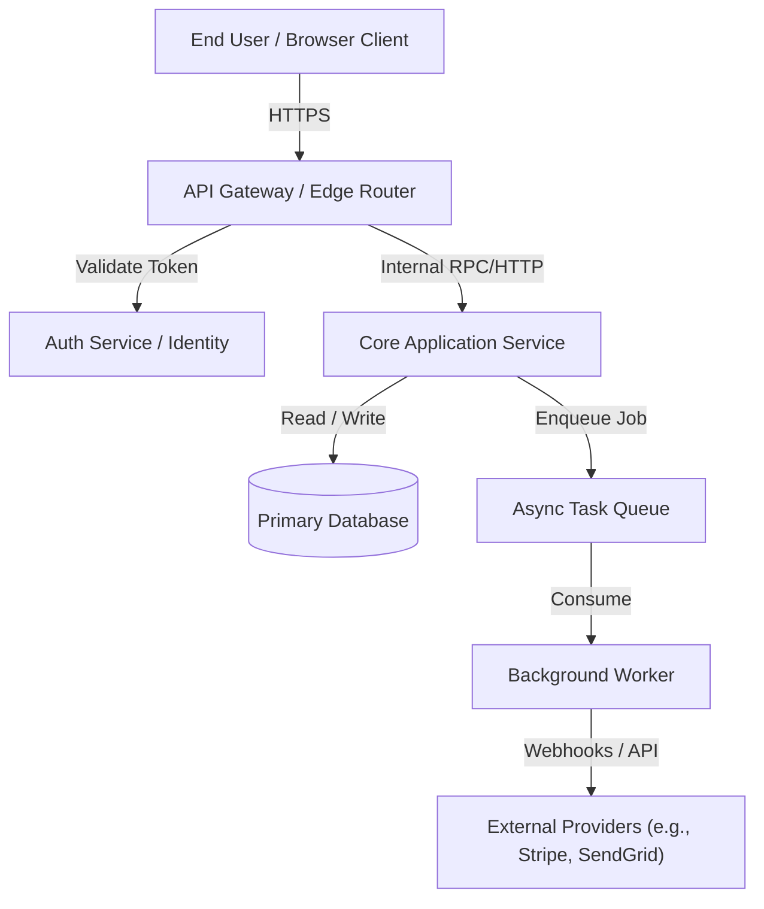

# System Architecture Overview: [SYSTEM_OR_SERVICE_NAME]

> **Document type:** Canonical Artifact Contract  
> **Artifact:** System Architecture Overview  
> **Primary Owner Skill:** `software-architecture`  
> **Canonical Destination Path:** `docs/architecture.md`  
> **Status:** `<Draft | Proposed | Accepted | Superseded>`  
> **Last updated:** `<YYYY-MM-DD>`  

---

## 1. Executive Summary & Quality Attributes (Required)

### High-Level Summary
[Concise summary of the architectural vision, technical stack, core component seams, and primary trade-offs.]

### Primary Quality Attribute Goals
1. **Performance / Latency:** [e.g., p95 response time < 150ms]
2. **Reliability / Availability:** [e.g., 99.9% uptime, zero single points of failure]
3. **Security / Privacy:** [e.g., Zero Trust boundaries, encrypted at rest and in transit]
4. **Maintainability / Deep Modules:** [e.g., Explicit seams, clear contract boundaries]

---

## 2. System Context & Boundaries (C4 Level 1 & 2) (Required)

### External Dependencies & Integrations (Required)
| External System | Purpose | Protocol / Contract | Failure Mode / Fallback |
|---|---|---|---|
| [Provider A] | [Auth / Payments / Email] | [REST / gRPC / Webhook] | [Circuit breaker / Retry queue] |

---

## 3. Component Breakdown & Data Ownership (Required)

| Component / Subsystem | Primary Responsibility | Data Owned (Single Source of Truth) | Public Interface / Seam |
|---|---|---|---|
| `auth` | Identity, session validation, RBAC | User accounts, sessions, API tokens | `IAuthService` |
| `billing` | Subscription lifecycle, invoices | Invoices, payment state, plans | `IBillingService` |
| `core` | Domain business logic | Workspaces, project assets | REST / GraphQL API |

---

## 4. Key Cross-Cutting Design Decisions (Required)

### Data Storage & Consistency
- **Primary Datastore:** [e.g., PostgreSQL, DynamoDB]
- **Consistency Model:** [Strong consistency for financials, eventual for metrics]
- **Caching Strategy:** [e.g., Redis read-through cache with TTL]

### Security & Trust Boundaries
- **Authentication:** [JWT / Session cookies / OIDC]
- **Authorization:** [RBAC / ABAC enforcement points]
- **Secrets Management:** [Cloud Secret Manager / Vault, never in code]

---

## 5. Architectural Decision Records (ADRs) Index (Optional)

| ADR ID | Decision Title | Status | Date |
|---|---|---|---|
| `ADR-001` | Selection of PostgreSQL for multi-tenant data (`docs/adr/ADR-001.md`) | Accepted | YYYY-MM-DD |
| `ADR-002` | Event-driven architecture for background jobs (`docs/adr/ADR-002.md`) | Accepted | YYYY-MM-DD |

---

## 6. Architectural Review & Conformance Gate (Required)
- [ ] System boundaries, C4 context, and component seams are clearly defined
- [ ] Quality attribute targets are measurable and trade-offs explicitly addressed in ADRs
- [ ] Data ownership follows single source of truth; zero ambiguous shared state
- [ ] Trust boundaries, authentication points, and secrets management comply with security baseline
- [ ] Architectural review sign-off recorded
- **Reviewed & Approved By:** [Lead Architect / Date]
