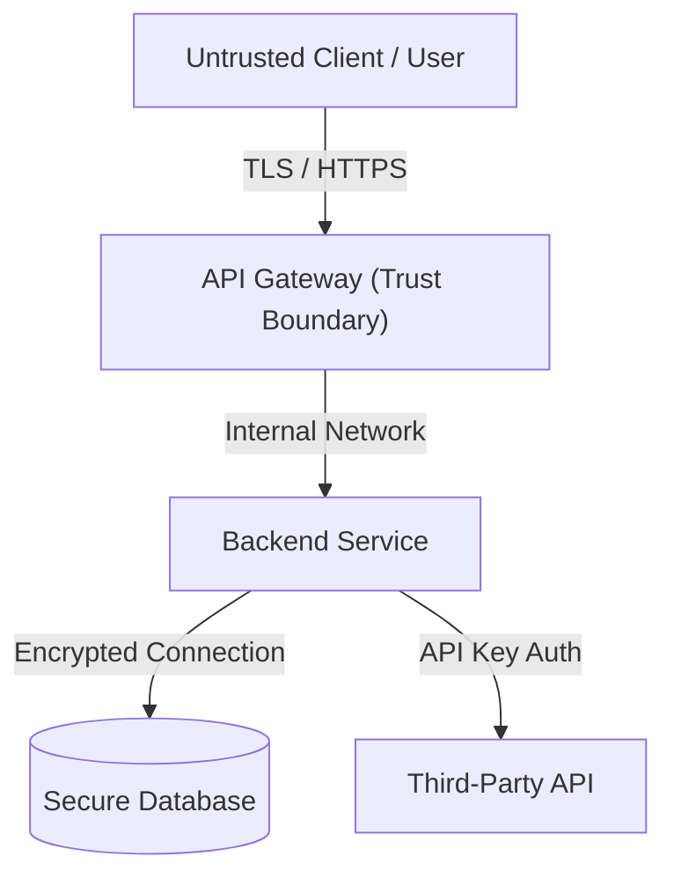

# STRIDE-A Threat Model: [SYSTEM_OR_FEATURE_NAME]

> **Document type:** Canonical Artifact Contract  
> **Artifact:** STRIDE-A Threat Model  
> **Primary Owner Skill:** `security-and-hardening`  
> **Canonical Destination Path:** `docs/security/threat-model-[system].md`  
> **Status:** `<Draft | In Review | Approved>`  
> **Last updated:** `<YYYY-MM-DD>`  

- **Analysis Date:** `[YYYY-MM-DD]`
- **Analyst(s):** `[Security Engineer / Tech Lead / Agent]`
- **Target Scope:** `[Subsystem / API / Feature]`
- **Methodology:** STRIDE-A (Spoofing, Tampering, Repudiation, Information Disclosure, Denial of Service, Elevation of Privilege, AI/LLM-specific)

---

## 1. System Scope & Data Flow Diagram (DFD) (Required)

### Trust Boundaries & Assets (Required)
- **Trust Boundary 1:** Public Internet $\leftrightarrow$ API Gateway (External ingress)
- **Trust Boundary 2:** Application Service $\leftrightarrow$ Database (Internal datastore)
- **Critical Assets:** User Credentials, PII, Payment Tokens, Session Secrets

---

## 2. STRIDE-A Threat Analysis & Mitigations (Required)

| ID | Threat Category | Threat Description & Attack Vector | Impact (High/Med/Low) | Concrete Mitigation Strategy | Status (Mitigated/Accepted) |
|---|---|---|---|---|---|
| `TM-001` | Spoofing | Attacker impersonates legitimate user via stolen JWT | High | Short-lived tokens, refresh rotation, asymmetric signing | Mitigated |
| `TM-002` | Tampering | Modification of request payload in transit | High | Strict TLS 1.3 enforcement, payload HMAC signature | Mitigated |
| `TM-003` | Repudiation | User denies initiating financial transfer | Med | Audit logging to append-only tamper-proof ledger | Mitigated |
| `TM-004` | Information Disclosure | PII leaked in debug logs or error traces | High | Structured logging sanitization; zero PII in error responses | Mitigated |
| `TM-005` | Denial of Service | Resource exhaustion via unbounded payload | Med | Rate limiting, request size limits, query timeouts | Mitigated |
| `TM-006` | Elevation of Privilege | Bypassing RBAC checks via IDOR | High | Strict server-side ownership checks on every access | Mitigated |
| `TM-007` | AI / LLM Abuse | Prompt injection overrides agent constraints | High | Input sanitization, strict tool execution boundaries | Mitigated |

---

## 3. Security Requirements for Implementation (Required)
- **Authentication & Token Lifecycle:** [Specification]
- **Input Validation & Sanitization:** [Schema validation library rules]
- **Secrets Management:** [Cloud Secret Manager / Vault, zero hardcoded keys]

---

## 4. Verification & Testing Evidence (Required)
- [ ] Automated security linting / SAST scan passing with zero critical findings
- [ ] Automated unit/integration tests verifying authorization and IDOR protection
- [ ] Negative test cases for malformed and malicious inputs passing
- **Security Approval Sign-off:** [AppSec Engineer / Tech Lead / Date]
